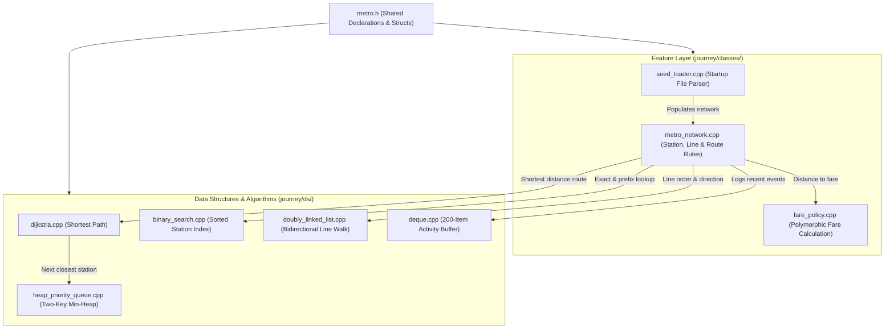
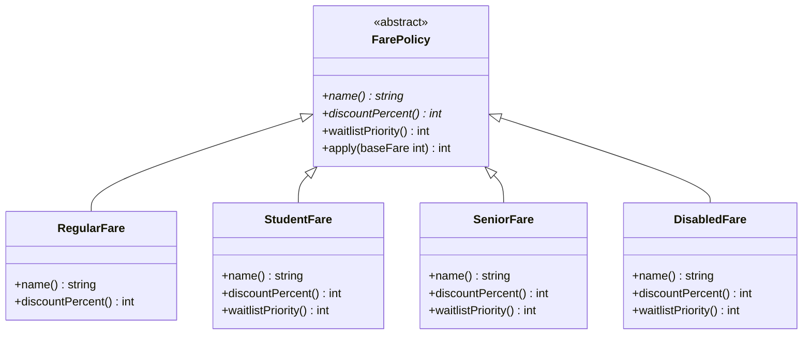

# Metro Transit System — Journey & Network Module (`journey/`)

**Author:** Aaryan Rawat (`Aaryan-Rawat28`)  
**Branch:** `aaryan`  
**Language:** C++17 (Zero STL containers, standard library I/O only)

This branch contains the **Journey and Network** subsystem of the Metro Transit System. It handles everything needed to model stations and metro lines, load the starting network from text files, search stations by name or prefix, find the shortest route between stations, calculate distance-based fares with passenger discounts, and maintain a recent activity log.

---

## Table of Contents

- [What This Module Does](#what-this-module-does)
- [Architecture & Flow Diagrams](#architecture--flow-diagrams)
  - [1. Module Architecture](#1-module-architecture)
  - [2. Journey Planning & Fare Flow](#2-journey-planning--fare-flow)
  - [3. FarePolicy Class Hierarchy](#3-farepolicy-class-hierarchy)
- [Folder Structure](#folder-structure)
- [Data Structures & Algorithms (`journey/ds/`)](#data-structures--algorithms-journeyds)
- [Core Classes & Features (`journey/classes/`)](#core-classes--features-journeyclasses)
- [Time Complexity](#time-complexity)
- [OOP Concepts Used](#oop-concepts-used)
- [Fare Rules & Seed Data Format](#fare-rules--seed-data-format)
- [Compile Check](#compile-check)

---

## What This Module Does

In simple terms, the `journey/` module acts as the **map, route planner, and fare calculator** of the metro system:

1. **Reads the starting map** (`seed_loader.cpp`) from plain text files (lines, stations, track distances, and initial accounts) and reports exact file and line numbers if anything is mistyped.
2. **Finds stations quickly** (`binary_search.cpp`) even if a user only types the first few letters (for example, typing `"raj"` suggests `"Rajiv Chowk"`).
3. **Finds the shortest path** (`dijkstra.cpp` + `heap_priority_queue.cpp`) between any two open stations, respecting closed stations when needed.
4. **Builds line views in both directions** (`doubly_linked_list.cpp`) so the system can walk forward or backward along a line and tell passengers which terminal station a train is heading towards (`"towards ..."`).
5. **Calculates ticket and card fares** (`fare_policy.cpp`) based on real track distance in meters and applies discounts based on passenger type.
6. **Checks if closing a station cuts off the network** (`metro_network.cpp`) and keeps a rolling log of the newest 200 actions (`deque.cpp`).

---

## Architecture & Flow Diagrams

### 1. Module Architecture



### 2. Journey Planning & Fare Flow


### 3. FarePolicy Class Hierarchy



---

## Folder Structure

```text
aaryan/
├── .gitignore
├── README.md
├── metro.h                             # Shared structs, class declarations, and function prototypes
└── journey/
    ├── ds/
    │   ├── binary_search.cpp           # Sorted station index, exact lookup, and prefix suggestions
    │   ├── deque.cpp                   # Circular-buffer double-ended queue
    │   ├── dijkstra.cpp                # Weighted shortest-path algorithm
    │   ├── doubly_linked_list.cpp      # Bidirectional linked list for metro lines
    │   └── heap_priority_queue.cpp     # Dynamic two-key binary min-heap
    └── classes/
        ├── fare_policy.cpp             # Distance fare slabs and polymorphic passenger discounts
        ├── metro_network.cpp           # Station/line management, routing, closure safety check
        └── seed_loader.cpp             # Reads and validates startup text files
```

| File | Category | Responsibility |
| :--- | :--- | :--- |
| `metro.h` | Shared Header | Declares `Graph`, `Route`, `Heap`, `Deque`, `DList`, `StationIndex`, `FarePolicy`, and `Metro`. |
| `journey/ds/dijkstra.cpp` | Algorithm | Finds the shortest route by meters between two stations using a min-heap. |
| `journey/ds/heap_priority_queue.cpp` | Data Structure | Two-key min-heap used by Dijkstra and priority ordering. |
| `journey/ds/binary_search.cpp` | Algorithm | Builds a case-insensitive sorted station table for fast name and prefix lookup. |
| `journey/ds/deque.cpp` | Data Structure | Circular dynamic array supporting $O(1)$ front/back push and pop. |
| `journey/ds/doubly_linked_list.cpp` | Data Structure | Doubly linked list used to inspect metro lines forward and backward. |
| `journey/classes/fare_policy.cpp` | OOP / Domain | Maps track meters to base fare and applies category discounts via virtual functions. |
| `journey/classes/metro_network.cpp` | Domain Logic | Implements `Metro` network setup, station/line queries, routing, and cut-off checks. |
| `journey/classes/seed_loader.cpp` | File I/O | Parses pipe-delimited seed files with UTF-8 BOM handling and line-numbered error messages. |

---

## Data Structures & Algorithms (`journey/ds/`)

| Data Structure / Algorithm | How It Works | Where It Is Used |
| :--- | :--- | :--- |
| **Dijkstra (`dijkstra.cpp`)** | Starts at the source station with distance `0` and all others at infinity (`LLONG_MAX`). Repeatedly pops the closest unvisited station from the min-heap and relaxes outgoing track edges (`meters`). Skips closed stations unless `allowClosed` is `true`. | Shortest-distance route planning and smart-card fare calculation. |
| **Two-Key Min-Heap (`heap_priority_queue.cpp`)** | Dynamic binary heap stored in a contiguous array (starts at capacity `16`, doubles on growth). Compares items by `key1` first, then breaks ties with `key2`. | Drives Dijkstra's priority queue (distance) and priority ordering (tier + sequence). |
| **Binary Search (`binary_search.cpp`)** | Lowercases all station names, sorts `StationIndexEntry` records, and runs both iterative and recursive binary search. `findByPrefix` uses lower-bound binary search to collect matching station IDs. | `Metro::findStation()` and `"Did you mean ...?"` station suggestions. |
| **Circular Deque (`deque.cpp`)** | Generic byte-buffer deque (`itemSize`) using modular wrap-around (`head`) and automatic capacity doubling from `8`. | Powers the `activity_` log, keeping the newest 200 events in $O(1)$ time. |
| **Doubly Linked List (`doubly_linked_list.cpp`)** | Heap-allocated `DNode` chain with `prev` and `next` pointers plus `head`/`tail` tracking. Supports front/back insertion, removal, index lookup, and full cleanup. | `Metro::makeLineList()` and `Metro::towardsStation()` for bidirectional line traversal. |

---

## Core Classes & Features (`journey/classes/`)

### `FarePolicy` (`fare_policy.cpp`)
- Abstract base class defining `name()`, `discountPercent()`, `waitlistPriority()`, and `apply(int baseFare)`.
- Derived classes (`RegularFare`, `StudentFare`, `SeniorFare`, `DisabledFare`) override the virtual methods so fare calculation works cleanly through a single `const FarePolicy&` reference.
- `fareForDistance(long long meters)` converts total track distance into base ticket slabs.

### `Metro` Network Operations (`metro_network.cpp`)
- **Constructor / Destructor (`Metro::Metro`, `Metro::~Metro`):** Allocates internal structures safely and frees all memory in `freeAll()` if any allocation fails or when `Metro` is destroyed.
- **Built-in Fallback (`loadDefaultNetwork`):** Loads 3 lines (`Blue`, `Yellow`, `Red`), 14 stations, 14 tracks, sample students, women's cards, and 2 demo smart cards if seed files are unavailable.
- **Network Management:** `addStation`, `addLine`, `addConnection`, `setStationOpen`, `linesAtStation`, `trackDistance`.
- **Routing & Safety:** `planRoute` (selects shortest distance or fewest stops), `suggestStations` (prefix match), `cutOffStations` (finds stations disconnected if a target station is closed), `makeLineList`, `isLoopLine`, `towardsStation`.

### Seed Loader (`seed_loader.cpp`)
- `loadStartingData(Metro&, folder, error, summary)` reads `lines.txt`, `stations.txt`, `connections.txt`, `students.txt`, `women_cards.txt`, and `cards.txt`.
- Ignores blank lines and `#` comments, strips UTF-8 BOM if present, trims whitespace around `|` separators, and rejects duplicate stations or negative distances with exact `file line N:` error messages.

---

## Time Complexity

| Operation | Complexity | Reason |
| :--- | :--- | :--- |
| Shortest route (`dijkstraRoute`) | $O((V + E) \log V)$ | Each vertex/edge relaxation uses binary min-heap `heapPush` / `heapPop` |
| Exact station lookup (`findInIndex`) | $O(\log V)$ | Binary search over sorted `StationIndexEntry` array |
| Prefix station search (`findByPrefix`) | $O(\log V + k)$ | Lower-bound binary search + scanning $k$ matching prefixes |
| Build station index (`buildStationIndex`) | $O(V \log V)$ | Copies $V$ station names and sorts them |
| Add/remove activity log (`dequeAddFront` / `dequeRemoveBack`) | $O(1)$ | Circular buffer index arithmetic (amortized on resize) |
| Line list traversal (`makeLineList` / `towardsStation`) | $O(L)$ | Walks $L$ stations along a single metro line using `DList` |
| Fare calculation (`fareForDistance`, `FarePolicy::apply`) | $O(1)$ | Constant-time slab comparison and integer percentage math |

---

## OOP Concepts Used

| Concept | Where It Appears in `journey/` |
| :--- | :--- |
| **Abstract Base Class & Pure Virtual Functions** | `FarePolicy` in `metro.h` (`name()` and `discountPercent()` are pure virtual `= 0`) |
| **Inheritance & Function Overriding** | `RegularFare`, `StudentFare`, `SeniorFare`, and `DisabledFare` inherit from `FarePolicy` and use `override` |
| **Runtime Polymorphism** | `farePolicy(int category)` returns `const FarePolicy&`, dispatching virtual calls at runtime |
| **RAII (Resource Acquisition Is Initialization)** | `RouteHolder` and `LineList` allocate resources in constructors and free them automatically in destructors |
| **Constructor & Destructor Resource Safety** | `Metro::Metro()` rolls back with `freeAll()` and throws `std::bad_alloc` on partial failure |
| **File Handling (`std::ifstream`)** | `seed_loader.cpp` parses and validates startup configuration files |

---

## Fare Rules & Seed Data Format

### Distance-Based Base Fares & Discounts

| Track Distance | Base Fare |
| :--- | :--- |
| Up to 2 km (`<= 2000 m`) | Rs. 10 |
| Up to 5 km (`<= 5000 m`) | Rs. 20 |
| Up to 12 km (`<= 12000 m`) | Rs. 30 |
| Up to 21 km (`<= 21000 m`) | Rs. 40 |
| Up to 32 km (`<= 32000 m`) | Rs. 50 |
| Above 32 km (`> 32000 m`) | Rs. 60 |

| Passenger Category | Discount | Final Fare Formula |
| :--- | :--- | :--- |
| Regular (`REGULAR`) | 0% | `baseFare` |
| Student (`STUDENT`) | 50% | `baseFare - (baseFare * 50) / 100` |
| Senior Citizen (`SENIOR`) | 30% | `baseFare - (baseFare * 30) / 100` |
| Person with Disability (`DISABLED`) | 50% | `baseFare - (baseFare * 50) / 100` |

### Startup Seed File Formats (`seed_loader.cpp`)

| File | Expected Format | Example |
| :--- | :--- | :--- |
| `lines.txt` | `name \| capacity \| frequency_minutes` | `Blue \| 6 \| 5` |
| `stations.txt` | `station_name` | `Rajiv Chowk` |
| `connections.txt` | `station_a \| station_b \| meters \| line_name` | `Airport \| City Mall \| 4200 \| Blue` |
| `students.txt` | `student_id` | `101` |
| `women_cards.txt` | `card_number` | `9001` |
| `cards.txt` | `name \| category \| student_id \| balance` | `Priya Negi \| student \| 101 \| 300` |

---

## Compile Check

This branch contains only the `journey/` module and `metro.h`. You can verify that every `.cpp` file in `journey/` compiles cleanly to object files:

**Windows (PowerShell):**
```powershell
g++ -std=c++17 -I. -c journey/classes/*.cpp journey/ds/*.cpp
```

**Linux / macOS:**
```bash
g++ -std=c++17 -I. -c journey/classes/*.cpp journey/ds/*.cpp
```

*(Full executable linking requires combining all subsystem folders on the `main` branch.)*
