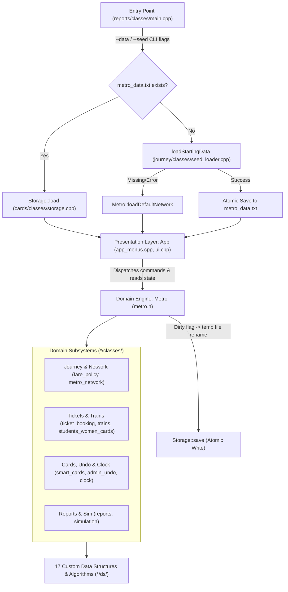
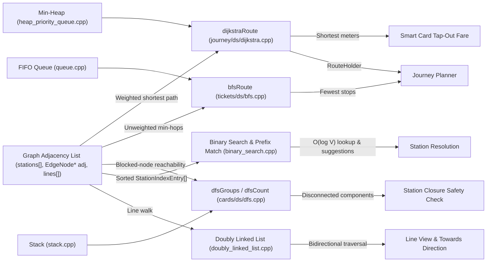

# Metro Transit System (C++17)


-orange?style=flat-square)


A modular, terminal-based **Metro Transit Management System** built in **C++17**. Passengers can plan multi-line journeys, book tickets with priority waitlisting, and travel using smart cards or passes; administrators can manage the transit network, trains, student/women's card registries, analytics reports, and rush-hour simulations.

- **Zero STL containers:** Built with a custom template `Array<T>` and **17 hand-implemented data structures and algorithms**—no `std::vector`, `std::map`, or external libraries.
- **Pure C++17 CLI:** Standard `cin`/`cout` terminal interface with no GUI dependencies, no color escape assumptions, and deterministic behavior.
- **Crash-safe persistence:** Network topology is seeded from editable `data/*.txt` files on first launch and persisted atomically to `metro_data.txt` after every mutation.

---

## Table of Contents

- [Key Capabilities](#key-capabilities)
- [System & Graph Architecture](#system--graph-architecture)
  - [Layered System Architecture](#1-layered-system-architecture)
  - [Graph & Routing Engine](#2-graph--routing-engine)
  - [Ticketing, Waitlist & Smart Card Flows](#3-ticketing-waitlist--smart-card-flows)
- [Project Structure](#project-structure)
- [Data Structures & Algorithms](#data-structures--algorithms)
- [Time Complexity Matrix](#time-complexity-matrix)
- [Object-Oriented Design](#object-oriented-design)
- [Business Rules & Fare Policy](#business-rules--fare-policy)
- [Getting Started](#getting-started)
  - [Prerequisites & Build](#prerequisites--build)
  - [Running & CLI Options](#running--cli-options)
  - [Demo Credentials & Seed Accounts](#demo-credentials--seed-accounts)
- [Menus & Operations](#menus--operations)
- [Starting Data & Network Topology](#starting-data--network-topology)
- [End-to-End Demo Walkthrough](#end-to-end-demo-walkthrough)
- [Testing & Quality Assurance](#testing--quality-assurance)
- [Team & Contributors](#team--contributors)

---

## Key Capabilities

- **Dual-Criteria Journey Planner:** Computes both the **shortest-distance route (Dijkstra)** and the **fewest-stops route (BFS)** across interchanges, reporting line changes, cumulative distances, and travel direction (`"towards ..."`).
- **Distance-Based Fares & Polymorphic Discounts:** Calculates fares from actual track distance with runtime-polymorphic concessions (`FarePolicy` hierarchy for Regular, Student, Senior Citizen, and Person with Disability).
- **Multi-Tier Priority Waiting List:** Min-heap ordered by passenger priority tier (1. Senior/Disabled, 2. Verified Women's Card, 3. Student, 4. Regular) with FIFO sequence tie-breaking and $O(1)$ lazy cancellation.
- **Smart Cards & Passes:** Card issuance, recharge, tap-in/tap-out with automatic shortest-path fare deduction, day/monthly passes, trip history linked lists, overstay penalties, and lost-card blocking with balance transfer.
- **Network Cut-Off Safety Check (DFS):** Before closing a station, runs iterative/recursive DFS to warn administrators which downstream stations would become unreachable.
- **BST vs. AVL Tree Benchmarking:** Indexes tickets in both an unbalanced BST and a self-balancing AVL tree to demonstrate structural height divergence ($1{,}000$ vs. $10$ at $1{,}000$ sequential tickets).
- **Admin Undo & Activity Audit Log:** Stack-backed multi-step undo for administrative mutations and a bounded 200-entry deque for recent system activity.
- **Rush-Hour Platform Simulation:** Models triangular arrival distributions using a fixed-capacity platform (`CircularQueue`) fed by an overflow station gate (`Queue`).
- **Automated Verification:** **13,669 automated test checks** across `tests/test_ds.cpp` and `tests/test_metro.cpp`, verified clean under AddressSanitizer and UndefinedBehaviorSanitizer.

---

## System & Graph Architecture

### 1. Layered System Architecture

The codebase enforces a strict separation between **presentation (`App`)**, **domain rules (`Metro`)**, **data structures (`*/ds/`)**, and **persistence (`Storage` / `seed_loader`)**. `Metro` never performs console I/O, enabling deterministic unit testing across all business rules.



### 2. Graph & Routing Engine

The transit network is modeled as an undirected, weighted multi-graph (`Graph` in `reports/ds/graph.cpp`), where stations are indexed vertices (`Station`) and track segments are adjacency-list edges (`EdgeNode`) carrying both physical distance (`meters`) and `line` ID. Every graph algorithm operates directly on this shared structure:



### 3. Ticketing, Waitlist & Smart Card Flows

```mermaid
flowchart TD
    Book["Metro::bookTicket"] --> Policy["FarePolicy::apply (Polymorphic Discount)"]
    Policy --> Cap{"Booked < Line Capacity?"}
    Cap -->|Yes| Confirm["Create Ticket: HashMap + BST + AVL"]
    Cap -->|No| Wait["Push WaitEntry to Line Min-Heap (key1=Priority, key2=Seq)"]

    Cancel["Cancel / Expire / Dispatch / Capacity Increase"] --> Promote["Metro::processWaitlist"]
    Wait --> Promote
    Promote -->|"Pop highest-priority active entry"| Confirm

    TapIn["Metro::tapIn (Check Status, Open Station, Balance >= Rs. 10 or Pass)"] --> Inside["Record entryStation & Clock::now()"]
    Inside --> TapOut["Metro::tapOut"]
    TapOut -->|"dijkstraRoute -> distance"| Deduct["Apply Pass / Fare + Overstay Penalty (> 180 min)"]
    Deduct --> History["Prepend Trip to Linked List (trips_)"]
```



---

## Project Structure

Every member owns a subsystem folder split cleanly into **`ds/`** (one file per data structure/algorithm) and **`classes/`** (business logic consuming those structures). All types, structs, and function prototypes are declared in the shared header **`metro.h`**.

```text
Metro-Transit-System-PBL/
├── metro.h                             # Shared contract: Graph, 17 DS APIs, Array<T>, FarePolicy, Metro, App
├── journey/                            # Member 1: Journey & Network
│   ├── ds/
│   │   ├── dijkstra.cpp                # Shortest-distance route (weighted graph)
│   │   ├── heap_priority_queue.cpp     # Two-key binary min-heap (Dijkstra & waitlist)
│   │   ├── binary_search.cpp           # Sorted station index & prefix suggestions
│   │   ├── deque.cpp                   # Circular-buffer deque (recent activity log)
│   │   └── doubly_linked_list.cpp      # Bidirectional line traversal ("towards ...")
│   └── classes/
│       ├── fare_policy.cpp             # FarePolicy hierarchy & distance slabs
│       ├── metro_network.cpp           # Metro lifecycle, network queries, route planning
│       └── seed_loader.cpp             # Parser & validator for data/*.txt
├── tickets/                            # Member 2: Ticketing & Trains
│   ├── ds/
│   │   ├── bfs.cpp                     # Fewest-stops route (unweighted BFS)
│   │   ├── avl_tree.cpp                # Self-balancing AVL ticket ID index & range queries
│   │   ├── bst.cpp                     # Unbalanced BST ticket index (height comparison)
│   │   └── queue.cpp                   # Linked-list FIFO queue (BFS & simulation gate)
│   └── classes/
│       ├── ticket_booking.cpp          # Booking, cancellation, expiry, boarding, waitlist
│       ├── students_women_cards.cpp    # Student & women's card registries, priority tiers
│       └── trains.cpp                  # Line train dispatch, capacity, next-train timetable
├── cards/                              # Member 3: Smart Cards & Persistence
│   ├── ds/
│   │   ├── dfs.cpp                     # Recursive & iterative DFS connectivity analysis
│   │   ├── hash_table.cpp              # Chaining hash table with dynamic resizing
│   │   ├── stack.cpp                   # Resizable array stack (admin undo & iterative DFS)
│   │   └── linked_list.cpp             # Generic singly linked list (card trip history)
│   └── classes/
│       ├── smart_cards.cpp             # Card issuance, recharge, tap-in/out, passes, lost-card transfer
│       ├── admin_undo.cpp              # Salted djb2 auth, lockout, undo stack, activity log
│       ├── storage.cpp                 # Atomic save/load serialization (metro_data.txt)
│       └── clock.cpp                   # Shared simulated clock
├── reports/                            # Member 4: Graph, Reports, Simulation & UI
│   ├── ds/
│   │   ├── graph.cpp                   # Weighted multi-line adjacency-list graph & route helpers
│   │   ├── quick_sort.cpp              # Median-of-three quick sort (tickets by fare)
│   │   ├── merge_sort.cpp              # Stable bottom-up/top-down merge sort (reports)
│   │   └── circular_queue.cpp          # Fixed-capacity ring buffer (simulation platform)
│   └── classes/
│       ├── reports.cpp                 # Revenue, busiest stations, popular routes, tree heights
│       ├── simulation.cpp              # Rush-hour discrete-minute simulation
│       ├── ui.cpp                      # Input validation, Table formatter, terminal helpers
│       ├── app_menus.cpp               # Interactive Passenger, Card, and Admin menus
│       └── main.cpp                    # CLI argument parsing (--data, --seed) & bootstrap
├── data/                               # Editable seed files (lines, stations, connections, cards, registries)
└── tests/
    ├── test_ds.cpp                     # 12,370 unit checks for all 17 data structures
    └── test_metro.cpp                  # 1,299 integration checks for Metro rules & persistence
```

---

## Data Structures & Algorithms

| Data Structure / Algorithm | Primary Role in System | Implementation File |
| :--- | :--- | :--- |
| **Graph (Adjacency List)** | Models stations as vertices and multi-line tracks as weighted edges | `reports/ds/graph.cpp` |
| **Dijkstra's Algorithm** | Shortest-distance route planning and smart-card tap-out fare calculation | `journey/ds/dijkstra.cpp` |
| **Binary Min-Heap (2 Keys)** | Priority queue for Dijkstra relaxation and multi-tier waiting list | `journey/ds/heap_priority_queue.cpp` |
| **Breadth-First Search (BFS)** | Route planning with the fewest station stops | `tickets/ds/bfs.cpp` |
| **FIFO Queue** | BFS frontier traversal and station gate queue in rush-hour simulation | `tickets/ds/queue.cpp` |
| **Depth-First Search (DFS)** | Recursive & iterative reachability checks before closing a station | `cards/ds/dfs.cpp` |
| **Stack** | Multi-step admin action undo and iterative DFS traversal | `cards/ds/stack.cpp` |
| **Hash Table (Chaining + Resize)** | $O(1)$ average lookup for cards, tickets, wait entries, students, women's cards | `cards/ds/hash_table.cpp` |
| **Singly Linked List** | Chronological journey/trip history per smart card | `cards/ds/linked_list.cpp` |
| **Doubly Linked List** | Bidirectional line inspection and `"towards ..."` direction labels | `journey/ds/doubly_linked_list.cpp` |
| **Deque** | Bounded recent-activity audit log (retains newest 200 entries) | `journey/ds/deque.cpp` |
| **Binary Search** | Exact station lookup by name and prefix autocomplete (`"Did you mean ...?"`) | `journey/ds/binary_search.cpp` |
| **Binary Search Tree (BST)** | Secondary ticket ID index demonstrating $O(n)$ skew on monotonic IDs | `tickets/ds/bst.cpp` |
| **AVL Tree** | Self-balancing ticket ID index for sorted display and `[low, high]` range queries | `tickets/ds/avl_tree.cpp` |
| **Merge Sort (Stable)** | Ranking top-5 busiest stations and popular routes in reports | `reports/ds/merge_sort.cpp` |
| **Quick Sort (Median-of-Three)** | Sorting all tickets by fare | `reports/ds/quick_sort.cpp` |
| **Circular Queue** | Fixed-capacity platform buffer in the rush-hour simulation | `reports/ds/circular_queue.cpp` |

---

## Time Complexity Matrix

| Operation | Complexity | Underlying Mechanism |
| :--- | :--- | :--- |
| Lookup card / ticket / student by ID | $O(1)$ average | Dynamic resizing hash table (`cards/ds/hash_table.cpp`) |
| Shortest-distance route | $O((V + E) \log V)$ | Dijkstra with binary min-heap (`journey/ds/dijkstra.cpp`) |
| Fewest-stops route | $O(V + E)$ | BFS over adjacency list (`tickets/ds/bfs.cpp`) |
| Station closure cut-off check | $O(V + E)$ | Iterative/recursive DFS (`cards/ds/dfs.cpp`) |
| Join / leave waiting list | $O(\log n)$ / $O(1)$ | Min-heap insert / lazy deletion flag (`WaitEntry::active`) |
| Find station by name / prefix | $O(\log V)$ | Binary search on sorted `StationIndex` (`journey/ds/binary_search.cpp`) |
| Ticket index insert / range query (AVL) | $O(\log n)$ / $O(\log n + k)$ | Self-balancing AVL tree (`tickets/ds/avl_tree.cpp`) |
| Ticket index insert (plain BST) | $O(n)$ | Degenerates into a chain because ticket IDs increase monotonically |
| Sort tickets by fare | $O(n \log n)$ average | Median-of-three quick sort (`reports/ds/quick_sort.cpp`) |
| Generate busiest stations / routes report | $O(T + k \log k)$ | $T$ trips aggregated + stable merge sort over $k$ stations/routes |
| Admin undo (`push` / `pop`) | $O(1)$ | Resizable array stack (`cards/ds/stack.cpp`) |
| Activity log insert / evict oldest | $O(1)$ | Ring-buffer deque (`journey/ds/deque.cpp`) |
| Simulation platform enqueue / dequeue | $O(1)$ | Fixed-capacity circular queue (`reports/ds/circular_queue.cpp`) |

---

## Object-Oriented Design

| OOP Concept | Implementation in Codebase |
| :--- | :--- |
| **Encapsulation & Separation of Concerns** | `Metro` owns all state privately; `App` handles UI/menus; `Storage` persists state. |
| **Abstract Class, Inheritance & Polymorphism** | `FarePolicy` abstract base class with virtual `name()`, `discountPercent()`, and `waitlistPriority()` overridden by `RegularFare`, `StudentFare`, `SeniorFare`, and `DisabledFare`. |
| **Class Template** | `Array<T>` (`metro.h`) — custom dynamic array replacing `std::vector`. |
| **Rule of Three (Copy, Assign, Destruct)** | `Array<T>` implements custom destructor, copy constructor, and copy assignment operator; `Metro` manages full lifecycle cleanup in `~Metro()`. |
| **Operator Overloading** | `Array<T>::operator[]` (const & mutable) and `Array<T>::operator=`. |
| **Friend Class** | `friend class Storage;` inside `Metro` grants serializer direct read/write access without exposing mutators publicly. |
| **Static Members** | `Clock` maintains a single global simulated time offset (`offsetSeconds_`) across the entire process. |
| **Exception Handling** | `ui::InputClosed` (derived from `std::runtime_error`) handles EOF cleanly by saving dirty state before exit. |
| **RAII Resource Management** | `RouteHolder` and `LineList` automatically free heap-allocated `Route` and `DList` resources upon scope exit. |
| **File I/O** | `seed_loader.cpp` parses pipe-delimited `data/*.txt`; `storage.cpp` writes `metro_data.txt.tmp` and atomically replaces `metro_data.txt`. |

---

## Business Rules & Fare Policy

| Rule | Specification |
| :--- | :--- |
| **Base Fare Slabs (by track meters)** | $\le 2\text{ km}$: Rs. 10 · $\le 5\text{ km}$: Rs. 20 · $\le 12\text{ km}$: Rs. 30 · $\le 21\text{ km}$: Rs. 40 · $\le 32\text{ km}$: Rs. 50 · $> 32\text{ km}$: Rs. 60 |
| **Category Discounts** | Student: `50%` · Person with disability: `50%` · Senior citizen: `30%` · Regular: `0%` |
| **Paper Ticket Validity** | Valid for **120 minutes** (2 hours); expired tickets release their reserved seat and trigger waitlist promotion |
| **Smart Card Trip Limit** | Max **180 minutes** (3 hours) per tap-in/tap-out; exceeding triggers a **Rs. 50** overstay penalty |
| **Smart Card Balance Limits** | Minimum **Rs. 10** to tap in · Max **Rs. 5,000** per recharge · Max **Rs. 10,000** total balance |
| **Passes** | Day Pass: **Rs. 200** · Monthly Pass: **Rs. 2,000** (category discount applies) |
| **Service Hours** | `06:00` to `23:00` daily |
| **Admin Security** | Salted `djb2` password hash; **3 failed attempts** lock admin login for **60 seconds** |

### Waiting-List Priority Order

When a seat opens (via cancellation, ticket expiry, train dispatch, or capacity increase), the min-heap promotes the highest-priority active entry:

1. **Tier 0:** Senior citizen or Person with disability
2. **Tier 1:** Woman with a verified women's card
3. **Tier 2:** Registered Student
4. **Tier 3:** Regular passenger

Within the same tier, entries are ordered strictly **FIFO** by monotonic sequence number (`seq`). A passenger qualifying for multiple tiers receives the highest applicable priority. A verified women's card grants waitlist priority only; fare discounts still follow passenger category.

---

## Getting Started

### Prerequisites & Build

Requires a **C++17** compiler (`g++` via MSYS2 UCRT64/MinGW-w64 on Windows, GCC, or Clang). Run from the repository root containing `metro.h`.

**Windows (PowerShell):**
```powershell
g++ -std=c++17 -I. (Get-ChildItem journey,tickets,cards,reports -Recurse -Filter *.cpp).FullName -o metro
.\metro.exe
```

**Linux / macOS:**
```bash
g++ -std=c++17 -I. $(find journey tickets cards reports -name "*.cpp") -o metro
./metro
```

**Explicit File List (Cross-Platform Fallback):**
```bash
g++ -std=c++17 -I. cards/classes/admin_undo.cpp cards/classes/clock.cpp cards/classes/smart_cards.cpp cards/classes/storage.cpp cards/ds/dfs.cpp cards/ds/hash_table.cpp cards/ds/linked_list.cpp cards/ds/stack.cpp journey/classes/fare_policy.cpp journey/classes/metro_network.cpp journey/classes/seed_loader.cpp journey/ds/binary_search.cpp journey/ds/deque.cpp journey/ds/dijkstra.cpp journey/ds/doubly_linked_list.cpp journey/ds/heap_priority_queue.cpp reports/classes/app_menus.cpp reports/classes/main.cpp reports/classes/reports.cpp reports/classes/simulation.cpp reports/classes/ui.cpp reports/ds/circular_queue.cpp reports/ds/graph.cpp reports/ds/merge_sort.cpp reports/ds/quick_sort.cpp tickets/classes/students_women_cards.cpp tickets/classes/ticket_booking.cpp tickets/classes/trains.cpp tickets/ds/avl_tree.cpp tickets/ds/bfs.cpp tickets/ds/bst.cpp tickets/ds/queue.cpp -o metro
```

### Running & CLI Options

```bash
./metro [--data FILE] [--seed FOLDER]
```

- `--data FILE`: Use a custom persistence file instead of `metro_data.txt`.
- `--seed FOLDER`: Load initial network configuration from a custom directory instead of `data/`.

### Demo Credentials & Seed Accounts

- **Default Admin Password:** `1234` (changeable inside the Admin panel)
- **Demo Smart Cards:** `5001` (Regular, Rs. 500) and `5002` (Student, Rs. 300)
- **Registered Student IDs:** `101`, `102`, `105`, `110`, `115`
- **Verified Women's Cards:** `9001`, `9002`, `9003`

---

## Menus & Operations

| Passenger Services | Smart Card Services | Admin Panel |
| :--- | :--- | :--- |
| View stations and lines | Get a new smart card | Add station, add line, add connection |
| View a line in both directions | Card details and balance | Close / reopen station (with DFS check) |
| Plan a journey (Dijkstra & BFS) | Recharge card | Register / deactivate student ID & view registry |
| Next trains and crowd levels | Tap in (enter a station) | Register / deactivate women's card & view registry |
| Book a ticket | Tap out (exit a station) | Train & waitlist status, dispatch train, set capacity |
| Cancel a ticket | Buy a day / monthly pass | View tickets by ID (AVL), by fare (Quick Sort), or ID range |
| Verify ticket and board | Journey history | Reports, recent activity log (Deque), undo action (Stack) |
| Check ticket or waitlist status | Report lost card | Rush-hour simulation & advance demo clock |
| Leave the waiting list | — | Change admin password & manual save |

---

## Starting Data & Network Topology

On first run (when `metro_data.txt` is absent), `seed_loader.cpp` parses plain-text pipe-delimited files in `data/` and writes the initial state to `metro_data.txt`. Subsequent runs load directly from `metro_data.txt`; delete `metro_data.txt` to re-seed from `data/`. If `data/` is missing, `Metro::loadDefaultNetwork()` loads a built-in 3-line, 14-station fallback network.

| Seed File | Record Type | Format (`#` comments and blank lines ignored) |
| :--- | :--- | :--- |
| `data/lines.txt` | Metro line | `name \| train capacity \| frequency in minutes` |
| `data/stations.txt` | Station | `name` |
| `data/connections.txt` | Weighted edge | `station A \| station B \| distance in metres \| line` |
| `data/students.txt` | Registered student | `student ID` |
| `data/women_cards.txt` | Verified women's card | `card number` |
| `data/cards.txt` | Demo smart card | `name \| regular/student/senior/disabled \| student ID (0 if none) \| balance` |

Validation errors pinpoint the exact file and line number (e.g., `data/connections.txt line 7: station 'Rajiv Chowkk' is not in data/stations.txt`).

### Built-In `data/` Network (6 Lines · 29 Stations · 39 Tracks)

```text
Blue:   Airport - City Mall* - Rajiv Chowk* - ISBT* - Railway Station - Clock Tower* - Old Market* - River Front
Yellow: Forest Institute - DU - Civil Lines* - Rajiv Chowk* - City Park* - Tech Park* - Graphic Era
Red:    ISBT* - Hospital - Exhibition Ground - City Park* - Stadium* - Sports Complex
Green:  Hill View - University - Science City* - Civil Lines* - Secretariat* - Clock Tower* - Bus Depot*
Pink:   Airport* - Aerocity - Transport Nagar - Industrial Area* - Stadium* - Tech Park* - Botanical Garden*
Ring:   City Mall* - Science City* - Secretariat* - Mall Road - Old Market* - Bus Depot*
        - Botanical Garden* - Industrial Area* - Lake View - (back to City Mall)
                                                              (* = interchange)
```

*(Default train capacity per line in `data/lines.txt` is `6` to make waitlist promotion easy to demonstrate; adjustable in the Admin panel.)*

---

## End-to-End Demo Walkthrough

1. **Route Finder:** Passenger $\to$ Plan a journey (`ISBT` to `City Park`). Dijkstra finds `2.4 km` on the Red Line; BFS finds `2 stops` (`4.8 km`, 1 interchange).
2. **Station Closure & Undo:** Admin $\to$ close `Hospital` $\to$ re-plan `ISBT` to `City Park` (reroutes via `Rajiv Chowk`) $\to$ Admin Undo restores `Hospital`.
3. **DFS Safety Check:** Attempt to close `Tech Park`; system warns `Graphic Era` would be cut off (`n` to abort).
4. **Priority Waiting List:** Set Blue Line capacity to `1`, book `Airport` $\to$ `City Mall`, then book 3 more passengers (Regular, Woman `9001`, Senior). Waitlist orders: Senior $\to$ Woman $\to$ Regular. Cancel ticket 1: Senior is promoted automatically.
5. **Concession Ticket:** Book `Airport` $\to$ `Graphic Era` as Student `101` with women's card `9002` (Rs. 40 base $\to$ Rs. 20 paid, showing interchange at `Tech Park`).
6. **Smart Card Trip:** Tap in `5001` at `Airport`, tap out at `Graphic Era` (Rs. 40 deducted for `12.5 km`); inspect journey history.
7. **Pass & Overstay:** Buy a day pass, tap in, advance clock by `200` minutes, tap out: Rs. 0 fare + Rs. 50 overstay penalty.
8. **Ticket Expiry:** Book a ticket, advance clock by `130` minutes, attempt to board: ticket expires and frees the seat.
9. **Line View & Prefix Search:** Inspect Blue Line and looping Ring Line; enter `raj` to trigger `"Did you mean: Rajiv Chowk?"`.
10. **AVL vs. BST & Quick Sort:** View tickets by ID (AVL), by fare (Quick Sort), and by ID range; inspect BST vs. AVL tree heights in Reports.
11. **Reports & Simulation:** View revenue, busiest stations, popular routes; run rush-hour simulation and compare average wait times across train frequencies.
12. **Persistence:** Exit, relaunch, and verify all state survives via `metro_data.txt`.

---

## Testing & Quality Assurance

Both test binaries compile with `-DMETRO_NO_MAIN` to swap in dedicated test harnesses.

**Windows (PowerShell):**
```powershell
$src = (Get-ChildItem journey,tickets,cards,reports -Recurse -Filter *.cpp).FullName
g++ -std=c++17 -I. -DMETRO_NO_MAIN tests/test_ds.cpp $src -o test_ds
.\test_ds.exe
g++ -std=c++17 -I. -DMETRO_NO_MAIN tests/test_metro.cpp $src -o test_metro
.\test_metro.exe
```

**Linux / macOS:**
```bash
src=$(find journey tickets cards reports -name "*.cpp")
g++ -std=c++17 -I. -DMETRO_NO_MAIN tests/test_ds.cpp $src -o test_ds && ./test_ds
g++ -std=c++17 -I. -DMETRO_NO_MAIN tests/test_metro.cpp $src -o test_metro && ./test_metro
```

- **`tests/test_ds.cpp` (12,370 checks):** Covers two-key heap tie-breaking, 10,000+ hash table insertions with dynamic rehashing, merge/quick sort stability & edge cases, Dijkstra vs. BFS correctness, recursive & iterative DFS, 5,000-node degenerate BST chain vs. all four AVL rotations, circular-queue wrap-around, deque, doubly linked list, and binary search.
- **`tests/test_metro.cpp` (1,299 checks):** Covers fare policies, routing, waitlist promotion & lazy leave, ticket expiry, smart cards, passes, overstay penalties, lost-card transfers, admin undo, login lockout, atomic save/load, corrupt-file recovery, reports, simulation, BST vs. AVL heights at 1,000 tickets, and seed-file error diagnostics.
- Verified with **AddressSanitizer** and **UndefinedBehaviorSanitizer** with zero memory leaks or undefined behavior.

---

## Team & Contributors

Built by a team of four, with each member owning a dedicated module (`journey/`, `tickets/`, `cards/`, `reports/`), its underlying data structures and algorithms, and its feature classes connected through `metro.h`.

| Member | Module | Role & Responsibilities | Data Structures & Algorithms |
| :--- | :--- | :--- | :--- |
| **Member 1** | `journey/` | Journey planning, fare policies, seed loading, stations, lines, closure checks | Dijkstra, Min-Heap, Binary Search, Deque, Doubly Linked List |
| **Member 2** | `tickets/` | Ticket booking, cancellation, expiry, priority waiting list, student/women registries, trains | BFS, AVL Tree, BST, Queue |
| **Member 3** | `cards/` | Smart cards, tap-in/out, passes, lost cards, admin login/undo, persistence, clock | DFS, Hash Table, Stack, Singly Linked List |
| **Member 4** | `reports/` | Analytics reports, rush-hour simulation, UI/table formatting, menus, `main()`, test suites | Graph (Adjacency List), Quick Sort, Merge Sort, Circular Queue |
